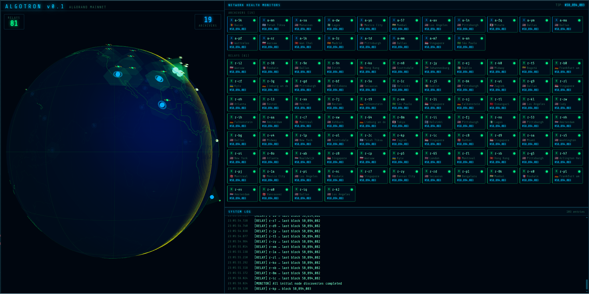
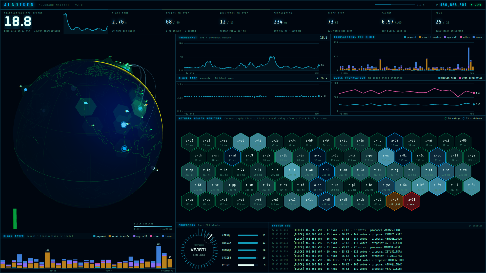

# Algotron

Real-time Algorand network monitoring dashboard with an Encom boardroom aesthetic.

Discovers every relay and archiver node via DNS SRV records, geolocates them, and tracks their block heights live.

[](https://youtu.be/VQqEQATW-7w)

Version 2 adds realtime chain statistics:



## Features

- **Live block tracking**: every node is polled about twice a second, once for all clients
- **Realtime chain stats from the nodes themselves**: TPS, block time, transactions per block by type,
  block size, certificate votes, proposer payouts and recent proposers, all decoded from the blocks the
  relays serve. No indexer, no algod API token
- **Block propagation**: how long relays take to show a block after the first one does
- **3D globe that replays every finished round**: a ring at the node that had the block first, one arc to every
  other node timed to land when the block reached it, and a flash where it lands, light for early and dark
  for late. Each replay is stretched to about two seconds; the key shows the round, the real time scale and
  the slowdown. Arrival times are measured; the arcs are drawn straight from the origin because gossip routes
  are not known
- **Dot-matrix land, bloom and an atmosphere rim** on the globe. Bloom switches itself off on a display that
  cannot hold about 25 frames per second (`?fx=1` forces it on, `?fx=0` off)
- **Honeycomb wall**: one hex per node, fastest reply first (re-ranked once a minute so hexes stay put),
  flashing in the same replay as the globe; hover for detail
- **Proposer ring, moments**: the current proposer on a ring in the globe's corner, and a
  banner for bursts, slow rounds and nodes that drop or recover
- **Status**: synced / lagging / behind / no answer (with the reason), IPv6 reachability per host
- **Boot terminal**: Encom-style discovery sequence on first load
- **Permissionless**: DNS SRV records and the public block endpoint are all it needs

## Live instance

https://algotron.algo.green

## Stack

| Layer    | Tech                                                      |
| -------- | --------------------------------------------------------- |
| Runtime  | Bun 1.4 (one process: UI, `/ws`, `/health`, `/api/state`) |
| Backend  | `Bun.serve` with native WebSocket pub/sub, no framework   |
| Frontend | React 19, Three.js, canvas charts, bundled by Bun         |
| Tooling  | `tsgo` typecheck, Biome lint + format, `bun test`         |
| Geo      | ip-api.com batch (no key required)                        |
| DNS      | SRV, A and AAAA via `node:dns/promises`                   |

## Getting started

**Prerequisite:** Bun 1.4+

```bash
bun install
bun dev          # http://localhost:3001, hot reload for backend and frontend
```

```bash
bun run typecheck && bun run lint && bun test
bun run build    # dist/server.js + assets; run with: cd dist && bun server.js
docker compose up -d --build
```

## Configuration

Environment variables, all optional:

| Variable          | Default                                    | Meaning                                                                                 |
| ----------------- | ------------------------------------------ | --------------------------------------------------------------------------------------- |
| `RELAY_SRV`       | `_algobootstrap._tcp.mainnet.algorand.net` | Relay SRV record (`NONE` to skip)                                                       |
| `ARCHIVER_SRV`    | `_archive._tcp.mainnet.algorand.net`       | Archiver SRV record (`NONE` to skip)                                                    |
| `NETWORK_ID`      | `mainnet-v1.0`                             | Genesis ID used in the block URL                                                        |
| `NETWORK_LABEL`   | `ALGORAND MAINNET`                         | Shown in the top bar                                                                    |
| `EXPLORER`        | `https://allo.info`                        | Base URL for block and account links                                                    |
| `HOST` / `PORT`   | `0.0.0.0` / `3001`                         | Listener. The image sets `HOST=::` (IPv4 and IPv6) so health checks on `localhost` work |
| `POLL_MS`         | `500`                                      | Pause between two polls of one node while no block is due                               |
| `FAST_POLL_MS`    | `100`                                      | Pause while a block is due (polled propagation resolution)                              |
| `BACKFILL_BLOCKS` | `240`                                      | Blocks loaded at start to fill the charts                                               |
| `AVMONITOR_URL`   | unset                                      | avmonitor v2 base URL; unset means polled propagation                                   |

The label and explorer are sent to the browser at runtime, so one image serves any network.

## How the numbers are made

Everything comes from `http://{ip}:{port}/v1/{genesis-id}/block/{round in base 36}`:

- **Node height**: `HEAD` for the round after the node's last one. `200` means it has it; `404` carries
  the header `X-Latest-Round` with the node's newest round, so one request is enough and there is no search.
- **Block stats**: one `GET` per new block, decoded from msgpack. Header fields used: `rnd`, `ts` (time),
  `tc` (chain-wide transaction counter), `prp` (proposer), `fc` (fees collected), `pp` (proposer payout);
  plus the payset (transaction types) and the certificate (vote count).
- **TPS**: growth of `tc` over the last 10 blocks divided by the `ts` time they span. `tc` counts inner
  transactions too, so "inner" in the chart is `tc` growth minus the top-level payset.
- **Propagation**: for each round, the delay between the first node showing the block and every other
  node showing it. Nodes are polled every `FAST_POLL_MS` (100 ms) from shortly before a block is due until
  they have it, and half the round trip is subtracted, so the resolution is about 100 ms. It is still a view
  from one vantage point of when a block is _served_, not of gossip arrival.

A node is marked **no answer** after three failed requests in a row. That is a statement about the path
from the machine running Algotron: a relay behind a firewall that drops this host looks the same as a
relay that is down. The card shows the reason (`timeout`, `refused`, `http 503`).

## avmonitor feed (optional)

Set `AVMONITOR_URL` (for example `ws://avmonitor.example:8080`) and the backend connects to avmonitor's
WebSocket protocol v2 (`/v2/stream?level=full&fmt=bin`, spec in the avmonitor repo, `docs/WS-PROTOCOL-V2.md`).
avmonitor sits on the gossip network and times every agreement vote at every relay, corrected for network
delay, so propagation is measured in milliseconds instead of polled.

- **Block wave**: per relay, the delay of the winning proposal vote after its first arrival at any relay.
  It feeds the wavefront, the honeycomb flash and the propagation chart. Gossip delays are tens of
  milliseconds, so the wave is replayed slowed down (the key says by how much).
- **Arrival curves** (full-width band at the bottom): the share of timed relays that have the winning
  proposal, the soft vote and the cert vote, on the round's own clock (ms after the round's first vote). A
  round first draws zoomed on two axes of one scale, the proposal from the left edge and soft and cert from a
  third of the width, then settles onto the whole-round axis among the ten rounds before it. Dashed lines
  mark where the soft and cert curves cross their consensus threshold share (2267/2990 and 1112/1500), by
  count, not stake. It runs at its own pace so every round fits before the next. Soft and cert are each
  relay's median vote delivery. Without avmonitor only the proposal curve shows. The **by relay / by
  address** switch redraws it with one step per voting account (for the proposal, per proposer), as if each
  account were a node: when its vote first reached any relay.
- **Sound** (switch on the health monitor, off by default): the wall as droplets, kalimba, a glass
  arpeggio, techno or an orchestra by continent, synthesised in the browser from the same arrivals the
  hexes flash. Droplets, kalimba and the orchestra sound with the flashes; the arpeggio and techno keep a
  steady bar of one block time and pick up the newest round at each bar line.
- **Vote boxes** (right column, bottom): for proposals, soft votes and cert votes, one box per round over the last 45
  rounds (whisker 5–95%, box 25–75%, tick at the median) of when the votes first reached any relay, and a
  strip counting them. A switch sets the zero: the round's first vote, or the first vote of that kind.
- **Soft and cert votes**: per relay, the median delivery relative to the fastest relay (shown on hover), and
  per round the time from the first vote to the median soft and cert vote.
- Relays are matched by address, then host. Nodes avmonitor does not cover (archivers) keep polled figures
  and stay out of the wave. If the feed stops for 20 s, polling takes over again.
- Rounds arrive `delay_rounds` late (about 6 s), and each one is replayed with its own measured delays,
  starting at the relay that had the winning proposal vote first.

Until the avmonitor v2 server exists, `bun backend/test/avmock.ts http://127.0.0.1:3001` serves made-up
timings in the real wire format for development.

## Project structure

```
shared/types.ts          wire types used by both sides
backend/src/
  server.ts              Bun.serve: static UI, /ws, /health, /api/state
  discovery.ts           SRV -> addresses -> geolocation -> node list (repeated every 15 min)
  monitor.ts             poll loops, tip, propagation, block ring
  probe.ts               HEAD / GET against the block endpoint
  blocks.ts, msgpack.ts, address.ts   block decoding
  avmonitor.ts           avmonitor v2 client: ROUND frame codec, per-relay vote timing
frontend/src/
  state.ts               WebSocket feed + reducer
  stats.ts               TPS, block time, proposers, fleet summary
  components/            Globe, VoteCurves, VoteBoxes, HexWall, Chart, Kpis, ProposerRing, Moments ...
```

## Message protocol

| Type             | When                                                                                               |
| ---------------- | -------------------------------------------------------------------------------------------------- |
| `hello`          | On connect: config, boot log, all nodes, recent blocks, tip                                        |
| `boot` / `ready` | Discovery log lines while the backend starts                                                       |
| `nodes`          | Batched node changes (add / patch / remove) and the tip, at most every 250 ms                      |
| `block`          | A new block's figures                                                                              |
| `block_patch`    | Propagation summary for a round, two rounds later                                                  |
| `wave`           | A finished round's first node and every other node's delay after it (avmonitor: soft and cert too) |
| `log`            | Monitoring events                                                                                  |

## Node status

| Status    | Colour | Condition                                  |
| --------- | ------ | ------------------------------------------ |
| `synced`  | green  | lag ≤ 1 round                              |
| `lagging` | yellow | lag 2–3 rounds                             |
| `behind`  | orange | lag > 3 rounds                             |
| `offline` | red    | 3 requests in a row without an HTTP answer |
| `unknown` | grey   | not probed yet                             |

## DNS bootstrap

- Relay SRV: `_algobootstrap._tcp.mainnet.algorand.net`
- Archiver SRV: `_archive._tcp.mainnet.algorand.net`
- Block URL: `http://{ip}:{port}/v1/{network-id}/block/{block_base36}`
